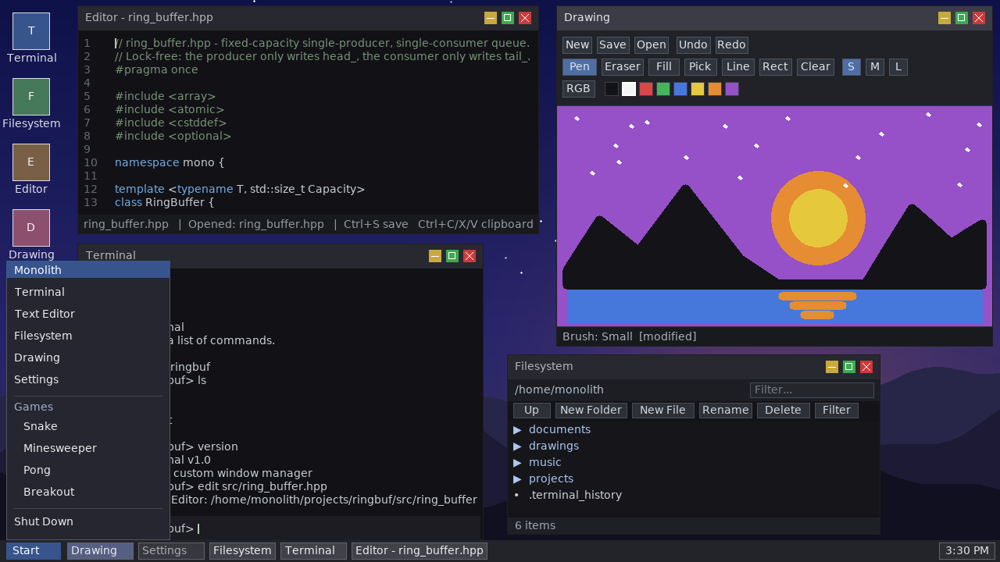

# Using the desktop

How to work with windows, the taskbar, the Start menu and the desktop icons. Each app has its own guide in [docs/README.md](README.md#apps).

## Windows

- Drag a window by its title bar.
- Resize it from any edge or corner. There is no snapping or tiling.
- The title bar buttons are minimize, maximize and close. Maximize fills the desktop above the taskbar. Press it again to restore the old size.
- Click a window to bring it to the front and give it keyboard focus.
- Several windows of one app get numbered titles: `Terminal`, `Terminal 2` and so on. Editor and Drawing windows with a file open are named after the file, for example `Editor - notes.txt`.
- Closing an Editor or Drawing window with unsaved changes asks first. See [text-editor.md](apps/text-editor.md#unsaved-changes) and [drawing.md](apps/drawing.md#unsaved-changes).

## Taskbar

- **Start** opens the Start menu.
- There is one button per window. Click a window's button to focus it. Click the focused window's button to minimize it.
- With many windows the buttons scroll with the arrow buttons or the mouse wheel.
- The clock is on the right, 12-hour by default (change it in [Settings](apps/settings.md#taskbar-clock)). Hover over it to see the full date.

## Start menu

- Open it with the Start button or Ctrl+Escape.
- Up / Down select a row, Enter launches it, or click a row. Games are under **Games**.
- Type to filter the rows by name. Backspace removes a character. Esc clears the filter, and a second Esc closes the menu.
- **Shut Down** quits MONOLITH. It is blocked while an Editor or Drawing window has unsaved changes.
- While the menu is open, the focused app is paused and gets no keys.

## Desktop icons

- Five icons on the left: Terminal, Filesystem, Editor, Drawing, Settings.
- Click once to select, click again within 450 ms to launch.
- Enter launches the selected icon when no window has keyboard focus.

## Keyboard shortcuts

| Key | Action |
|-----|--------|
| Alt+Tab | Focus the next window |
| Alt+Shift+Tab | Focus the previous window |
| Ctrl+Escape | Open or close the Start menu |

## Sessions

When you quit, MONOLITH saves the open windows, their positions and the files open in Editor and Drawing to `~/.monolith/session.txt`. They come back on the next launch. With no saved session it opens Terminal, Filesystem, Text Editor on `welcome.txt`, and Settings. Details: [window-manager.md](internals/window-manager.md#session-restore).
